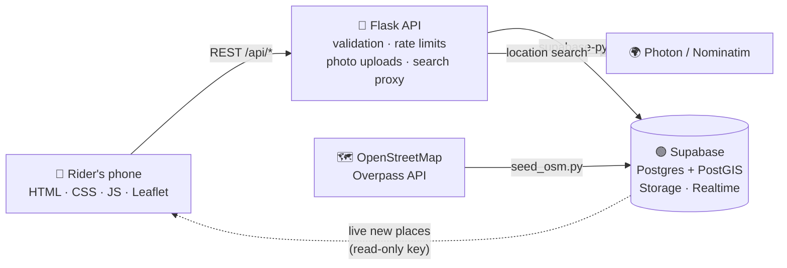

<div align="center">


# RestStop

### Toilets, drinking water, charging and shade for the people who deliver our cities.

A crowdsourced, rider-verified map built for delivery and gig workers, in Hindi and English.

[](https://www.python.org/)
[](https://flask.palletsprojects.com/)
[](https://supabase.com/)
[](https://leafletjs.com/)
[](https://www.openstreetmap.org/)
[](#features)

**Built for the _Hack the Unseen_ hackathon**

[The problem](#the-problem) · [Features](#features) · [How it works](#how-it-works) · [Getting started](#getting-started) · [API](#api-reference) · [Roadmap](#roadmap)

</div>

<br>


## The problem

Every day, delivery riders spend long hours on the road bringing us food, groceries and parcels. When they need a toilet, a drink of water, somewhere to charge their phone or a minute in the shade, **there's often nowhere to go.**

- Many shops and restaurants turn riders away.
- Public toilets and water points exist but are hard to find, and nobody knows which ones still work.
- **Women riders** face this most, with very few places they can trust to be safe.

Everyone depends on these workers, yet almost nobody thinks about where they rest. It's a problem hidden in plain sight, and that's what *Hack the Unseen* asked us to find.

## The solution

**RestStop** is a map of places where riders are welcome, built and kept accurate by riders themselves.

| 🔎 Find | ✅ Verify | 🤝 Welcome |
|:---|:---|:---|
| See the nearest toilet, water point, charging point or shade, filtered for what's needed right now. | Riders confirm a place still works or flag that it's closed, so the map stays trustworthy. | Shop owners mark their shop as **rider-friendly** and open their doors. |

It launches with **1,200+ real public toilets and water points across Delhi**, imported from OpenStreetMap, so it's useful from the first day. The community fills in the rest.

## Screenshots

<p align="center">
  
</p>
<p align="center"><sub><b>Mobile:</b> nearby places · search any area or landmark · place details with rider verification</sub></p>

<br>

<p align="center">
  
</p>
<p align="center"><sub><b>Live impact dashboard</b>, updated as riders add and verify places</sub></p>

## Features

**Finding a place**
- 🗺️ **Nearby map and list:** places around the rider's live location, nearest first
- 📍 **Location search:** any area, landmark or address, with suggestions as you type
- 🔍 **Filters:** toilet · water · charging · shade · women-safe · rider-friendly · open now
- 🧭 **One-tap navigation:** opens Google Maps two-wheeler directions
- 🎤 **Voice search:** say *"पानी"* or *"toilet"* without typing while on the bike
- 🧭 **Never a dead end:** if nothing is nearby, RestStop points to the nearest matching place

**Keeping it trustworthy**
- ✅ **Rider verification:** *"Verified by 12 riders · last checked 2 h ago"*
- ⚑ **Problem reports:** dirty, unsafe, wrong location or not allowed in
- 🔴 **Doubtful places fade out** when more riders report them closed than working

**Growing the map**
- ➕ **Add a place in under a minute:** search or drop a pin, tick facilities, add hours and a photo
- ⭐ **Rider-friendly shops:** owners welcome riders and get a badge on the map
- ⚡ **Live updates:** a new place appears on every open map instantly

**Built for riders**
- 🇮🇳 **Hindi and English** across the whole app, switched with one tap
- 🛡️ **Safety share:** send your live location on WhatsApp in one tap
- 📱 **Installable app:** add to the home screen, and it opens offline
- 👆 **Large buttons** for use on the move, and photos are compressed on the phone to save data

## How it works



1. The phone sends its location to **`/api/places`**.
2. Flask calls the **`nearby_places`** PostGIS function, which returns places within the visible area, nearest first, with verification counts.
3. Riders' actions (add, verify, report) go through Flask, which **validates every field**, checks photo type and size, and **rate-limits** each rider.
4. New places are broadcast through **Supabase Realtime**, so every open map updates.

### Security and privacy

- The **secret service key never leaves the server**. The browser only receives the public anon key.
- **Row-level security** limits that public key to *reading* places. All writes go through the API.
- Riders are **anonymous**: identified only by a random ID stored on their device, with no sign-up and no personal data.
- A rider's location is used only to find nearby places and **is not saved in the database**. Only the locations of places that riders add are saved.

## Tech stack

| Layer | Technology | Why |
|---|---|---|
| Frontend | HTML, CSS and JavaScript | No build step, fast on low-end phones |
| Map | [Leaflet](https://leafletjs.com/) + OpenStreetMap tiles | Free and open, no API key |
| Backend | Python, [Flask](https://flask.palletsprojects.com/) | Simple, readable API |
| Database | [Supabase](https://supabase.com/): Postgres + **PostGIS** | Fast geographic queries |
| Storage | Supabase Storage | Place photos |
| Realtime | Supabase Realtime | Live map updates |
| Search | [Photon](https://photon.komoot.io/), with [Nominatim](https://nominatim.org/) as fallback | OpenStreetMap-based, no API key |
| Seed data | [Overpass API](https://overpass-api.de/) | Real public toilets and water points |
| Voice | Web Speech API | Hindi (`hi-IN`) and English (`en-IN`) |

## Getting started

### Prerequisites

- **Python 3.10+.** On macOS, run `brew install python@3.12`; the built-in Python 3.9 has an outdated SSL library.
- A free [Supabase](https://supabase.com) account

### 1. Clone and install

```bash
git clone https://github.com/anshrjpt/reststop.git
cd reststop

python3.12 -m venv .venv
source .venv/bin/activate          # Windows: .venv\Scripts\activate
pip install -r requirements.txt
```

### 2. Set up Supabase

1. Create a new project. Pick the region closest to your users, such as **South Asia (Mumbai)**.
2. Open **SQL Editor**, paste the full contents of [`schema.sql`](schema.sql) and click **Run**. This creates the tables, PostGIS functions, security policies, Realtime publication and the `photos` storage bucket. It's safe to re-run.
3. Under **Project Settings → API Keys → Legacy API keys**, copy the **anon** and **service_role** keys, and copy the **Project URL** from **Project Settings → Data API**.
4. Create your environment file:

   ```bash
   cp .env.example .env
   ```

   ```ini
   SUPABASE_URL=https://your-project-ref.supabase.co
   SUPABASE_SERVICE_KEY=your-service-role-key   # secret, server only
   SUPABASE_ANON_KEY=your-anon-key              # public, enables live updates
   PORT=8000
   ```

> [!WARNING]
> Never commit `.env` or share the `service_role` key publicly; it has full access to your database. `.env` is already in `.gitignore`.

### 3. Load real data

Import public toilets and drinking water points from OpenStreetMap around any location:

```bash
# 20 km around Connaught Place, New Delhi
python seed_osm.py --lat 28.6315 --lng 77.2167 --radius 20000 --dry-run                          # preview
python seed_osm.py --lat 28.6315 --lng 77.2167 --radius 20000 --cache osm_cache_delhi.json      # import
```

- Re-running is safe: existing places are updated, not duplicated.
- The public servers are often busy. The script retries across four mirrors, and `--cache` saves the download so a re-run skips it.
- The map opens on New Delhi. For another city, change `DEFAULT_CENTER` in [`static/js/common.js`](static/js/common.js).

### 4. Run

```bash
python app.py
```

Open **http://localhost:8000**.

### 5. Open it on a phone

Browsers only share location over **HTTPS**, so expose the local server with a tunnel:

```bash
brew install cloudflared
cloudflared tunnel --url http://localhost:8000
```

Open the printed `https://…trycloudflare.com` link on your phone. To install it like an app, use the Chrome menu → **Add to Home screen**.

## API reference

All endpoints return JSON. Errors look like `{ "error": "message" }` with a 4xx or 5xx status.

| Method | Endpoint | Description |
|---|---|---|
| `GET` | `/api/places` | Places near `lat`, `lng` within `radius` metres (100–25,000), nearest first. Optional filters set to `=1`: `toilet`, `water`, `charging`, `shade`, `women_safe`, `rider_friendly`, `open_now` (with `time=HH:MM`). If none match, also returns `nearest`. |
| `GET` | `/api/places/<id>` | One place with verification counts |
| `POST` | `/api/places` | Add a place (multipart form): `name`, `lat`, `lng`, `category`, facility flags, optional `open_time`/`close_time`, optional `photo` (JPEG, PNG or WebP, up to 5 MB) |
| `POST` | `/api/places/<id>/verify` | `{ "user_id", "status": "works" \| "closed" \| "denied" }`, one vote per rider per place |
| `POST` | `/api/places/<id>/report` | `{ "user_id", "reason": "dirty" \| "unsafe" \| "wrong_location" \| "denied_access" \| "other", "note"? }` |
| `GET` | `/api/geocode` | Location search: `q`, plus optional `lat`/`lng` to rank nearby results first |
| `GET` | `/api/stats` | Totals for the impact dashboard |
| `GET` | `/api/config` | Public Realtime configuration |

**Rate limits per rider:** 15 new places per hour, 60 verifications or reports per hour, 60 searches per minute.

## Project structure

```
reststop/
├── app.py                 Flask API, also serves the frontend
├── schema.sql             Tables, PostGIS functions, security policies, storage
├── seed_osm.py            OpenStreetMap importer
├── requirements.txt
├── .env.example           Environment template
├── docs/
│   ├── TEAM.md            Team workflow, demo script, troubleshooting
│   └── screenshots/
└── static/
    ├── index.html         Map, list and place details
    ├── add.html           Add a place
    ├── dashboard.html     Impact dashboard
    ├── css/style.css      Design system
    ├── icons.svg          Icon set
    ├── manifest.json      Installable app manifest
    ├── sw.js              Service worker
    └── js/
        ├── common.js      Hindi/English text, API helper, rider ID
        ├── search.js      Location search box
        ├── map.js         Map, filters, details, verification, voice, realtime
        ├── add.js         Add-place form, pin picker, photo compression
        └── dashboard.js   Impact stats
```

## Impact

| For | What changes |
|---|---|
| **Riders** | Less time searching, safer breaks, and women-safe places they can find and trust |
| **Shops** | The rider-friendly badge brings footfall and goodwill |
| **Delivery platforms** | A ready-made welfare feature that could be built into rider apps |
| **Cities** | Places where riders search and find nothing show exactly where public toilets and water points are missing |

## Roadmap

- [ ] **"Toilet desert" heatmap:** areas with no facilities within 1 km, as evidence for city planners
- [ ] **QR stickers** for rider-friendly shops: scan to verify instantly
- [ ] **Phone-number login** to strengthen trust in verifications
- [ ] **Facilities along a route,** not just near a point
- [ ] **More languages:** Tamil, Telugu, Bengali, Marathi and Kannada
- [ ] **Coverage for more cities:** Mumbai, Bengaluru, Hyderabad and Chennai

## Limitations

- **Data quality depends on the community.** Verification counts and problem reports are the trust signal.
- **OpenStreetMap data is incomplete.** Many imported places are unnamed ("Public toilet") or have no opening hours. Few are tagged with charging or women-safe information, which riders add.
- **Anonymous IDs** can be reset by clearing browser data. A production version would add phone login.
- **Voice search** requires Chrome.

## Acknowledgements

- Map data © [OpenStreetMap](https://www.openstreetmap.org/copyright) contributors, available under the [ODbL](https://opendatacommons.org/licenses/odbl/)
- Search by [Photon](https://photon.komoot.io/) (komoot) and [Nominatim](https://nominatim.org/)
- Maps by [Leaflet](https://leafletjs.com/) · Backend by [Supabase](https://supabase.com/)
- Fonts: [Inter](https://rsms.me/inter/) and [Noto Sans Devanagari](https://fonts.google.com/noto/specimen/Noto+Sans+Devanagari)

<div align="center">
<br>

**RestStop: because the people who keep our cities running deserve a place to rest.**

</div>
