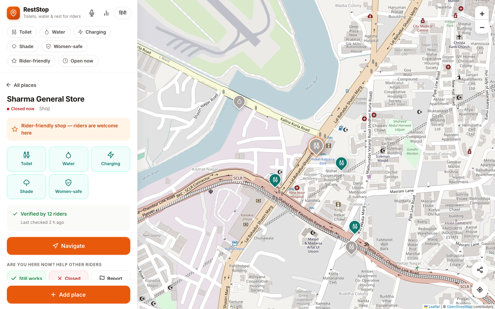
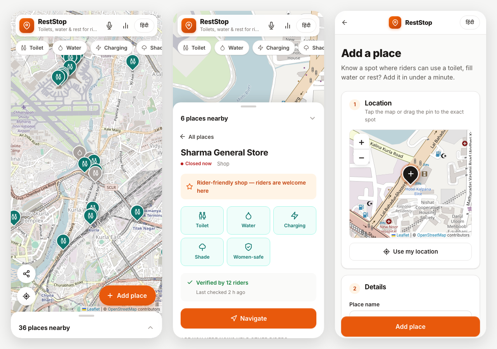
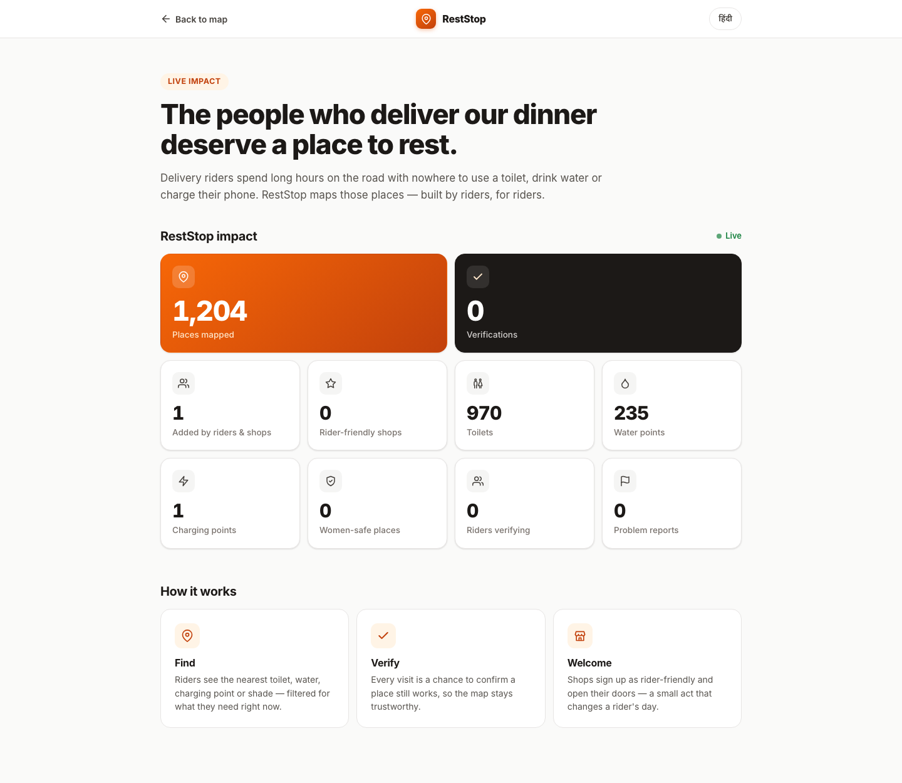
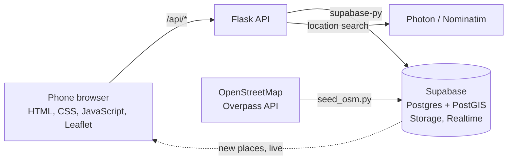

<div align="center">


# RestStop

Toilets, drinking water, charging points and shade for delivery riders.

[](https://www.python.org/)
[](https://flask.palletsprojects.com/)
[](https://supabase.com/)
[](https://leafletjs.com/)
[](LICENSE)

</div>

RestStop is a map of places where delivery riders can use a toilet, refill water, charge their phone or rest in the shade. Riders add the places, confirm they still work and report the ones that don't. Shops can mark themselves as rider-friendly. The app works in Hindi and English and runs in any phone browser.

We built it for the *Hack the Unseen* hackathon, which asked for problems that hide in plain sight.



## Contents

- [Why we built this](#why-we-built-this)
- [What it does](#what-it-does)
- [Screenshots](#screenshots)
- [How it works](#how-it-works)
- [Running it locally](#running-it-locally)
- [API](#api)
- [Project structure](#project-structure)
- [What's next](#whats-next)
- [Known limitations](#known-limitations)
- [Team](#team)
- [Credits](#credits)
- [License](#license)

## Why we built this

Delivery riders spend most of their working day on the road. When they need a toilet or a glass of water, the options are poor. Many shops and restaurants won't let them in, public toilets are hard to find, and there's no way to know whether a given one is open or clean. For women riders it's harder still.

Most of us order food or parcels several times a week and never think about this. Riders have mostly learned to live with it. That made it a good fit for the hackathon theme: a real, everyday problem that nobody notices unless it's theirs.

## What it does

**Find a place.** The map shows toilets, water points, charging points and shaded spots near the rider, nearest first. Filters narrow the results to what's needed right now, including women-safe places, rider-friendly shops and places open at the current time. Riders can search for any area, landmark or address, or use voice search in Hindi or English. A Navigate button opens Google Maps with two-wheeler directions. If nothing is nearby, the app says so and points to the nearest matching place instead of showing an empty map.

**Keep it accurate.** Each place shows how many riders have confirmed it still works and when it was last checked. Riders can mark a place as closed or report a problem, such as dirty, unsafe, wrong location or not allowed in. Places that more riders report as closed than working are faded on the map.

**Add new places.** Adding a place takes under a minute: search for the address or drop a pin, choose the facilities, and optionally add opening hours and a photo. Photos are resized on the phone before upload to save data. Shop owners can mark their shop as rider-friendly, which adds a badge on the map. New places appear on every open map straight away.

**Details for riders.**
- Hindi and English across the whole app, switchable at any time
- A button to send your current location to someone on WhatsApp
- Large buttons that are easy to tap on the move
- Installable on the home screen, with the app shell available offline

The map starts with about 1,200 public toilets and drinking water points across Delhi, imported from OpenStreetMap, so it's useful before anyone has added anything.

## Screenshots

<p align="center">
  
</p>
<p align="center"><sub>On a phone: the nearby list, location search, and a place's details with rider verification.</sub></p>

<p align="center">
  
</p>
<p align="center"><sub>The impact page, which updates as riders add and verify places.</sub></p>

## How it works



The browser sends the rider's location to the Flask API. Flask calls a PostGIS function, `nearby_places`, which returns the places within the visible area, sorted by distance and with their verification counts. Adding, verifying and reporting all go through Flask, which validates the input, checks photo type and size, and rate-limits each rider. Supabase Realtime pushes newly added places to every open map.

Location search goes through Flask to Photon, an OpenStreetMap-based geocoder that supports search as you type. If Photon fails or finds nothing, Flask falls back to Nominatim, restricted to India. Results are cached on the server.

### Security and privacy

- The Supabase service key stays on the server. The browser only receives the public anon key.
- Row-level security limits the anon key to reading places. All writes go through the API.
- Riders don't sign up. Each one gets a random ID stored on their own device.
- A rider's location is used to find nearby places and isn't saved in the database. Only the locations of places that riders add are stored.

### Tech stack

| Layer | Technology |
|---|---|
| Frontend | HTML, CSS and JavaScript, with no framework or build step |
| Map | Leaflet with OpenStreetMap tiles |
| Backend | Python and Flask |
| Database | Supabase (Postgres with PostGIS) |
| Photos | Supabase Storage |
| Live updates | Supabase Realtime |
| Location search | Photon, with Nominatim as fallback |
| Seed data | OpenStreetMap, through the Overpass API |
| Voice search | Web Speech API |

We kept the frontend framework-free on purpose. It loads quickly on cheap phones and slow connections, which is what most riders have.

## Running it locally

You'll need Python 3.10 or newer and a free [Supabase](https://supabase.com) account. On macOS, install Python with `brew install python@3.12`, because the built-in Python 3.9 has an outdated SSL library that fails to connect to some of the services we use.

### 1. Install

```bash
git clone https://github.com/anshrjpt/reststop.git
cd reststop

python3.12 -m venv .venv
source .venv/bin/activate          # on Windows: .venv\Scripts\activate
pip install -r requirements.txt
```

### 2. Set up Supabase

1. Create a project. The Mumbai region is the closest for users in India.
2. Open the SQL Editor, paste in the whole of [`schema.sql`](schema.sql) and run it. This creates the tables, the PostGIS functions, the security policies, the Realtime setup and a public `photos` storage bucket. It's safe to run more than once.
3. Under Project Settings, API Keys, open the Legacy API keys tab and copy the `anon` and `service_role` keys. The Project URL is under Project Settings, Data API.
4. Copy the environment template and fill it in:

   ```bash
   cp .env.example .env
   ```

   ```ini
   SUPABASE_URL=https://your-project-ref.supabase.co
   SUPABASE_SERVICE_KEY=your-service-role-key
   SUPABASE_ANON_KEY=your-anon-key
   PORT=8000
   ```

### 3. Import places from OpenStreetMap

```bash
# Preview what's available within 20 km of Connaught Place, New Delhi
python seed_osm.py --lat 28.6315 --lng 77.2167 --radius 20000 --dry-run

# Import it
python seed_osm.py --lat 28.6315 --lng 77.2167 --radius 20000 --cache osm_cache_delhi.json
```

Running the import again updates existing places instead of duplicating them. The public Overpass servers are often busy, so the script retries across four mirrors, and `--cache` keeps a copy of the download so you don't have to fetch it twice.

The map opens on New Delhi. For another city, change `DEFAULT_CENTER` at the top of [`static/js/common.js`](static/js/common.js).

### 4. Start the server

```bash
python app.py
```

Then open http://localhost:8000.

### 5. Try it on a phone

Phones only share their location with HTTPS sites, so a plain local address like `http://192.168.1.5:8000` won't be able to find the rider. The simplest workaround is a Cloudflare tunnel:

```bash
brew install cloudflared
cloudflared tunnel --url http://localhost:8000
```

Open the `https://…trycloudflare.com` address it prints on your phone. In Chrome, choose Add to Home screen from the menu to install it like an app.

## API

Every endpoint returns JSON. Errors come back as `{ "error": "..." }` with a 4xx or 5xx status code.

| Method | Endpoint | What it does |
|---|---|---|
| `GET` | `/api/places` | Places within `radius` metres (100 to 25,000) of `lat`/`lng`, nearest first. Optional filters, each set to `1`: `toilet`, `water`, `charging`, `shade`, `women_safe`, `rider_friendly`, `open_now` (used with `time=HH:MM`). When nothing matches, the response also includes the `nearest` matching place within 50 km. |
| `GET` | `/api/places/<id>` | One place, with its verification counts |
| `POST` | `/api/places` | Adds a place from a multipart form: `name`, `lat`, `lng`, `category`, the facility flags, optional `open_time` and `close_time`, and an optional `photo` (JPEG, PNG or WebP, up to 5 MB) |
| `POST` | `/api/places/<id>/verify` | `{ "user_id", "status" }`, where status is `works`, `closed` or `denied`. One vote per rider per place; voting again replaces the earlier vote. |
| `POST` | `/api/places/<id>/report` | `{ "user_id", "reason", "note" }`, where reason is `dirty`, `unsafe`, `wrong_location`, `denied_access` or `other` |
| `GET` | `/api/geocode` | Location search for `q`. Optional `lat`/`lng` rank nearby results higher. |
| `GET` | `/api/stats` | Totals for the impact page |
| `GET` | `/api/config` | The public settings the browser needs for live updates |

Limits: 15 new places per hour, 60 verifications or reports per hour, and 60 searches per minute.

## Project structure

```
reststop/
├── app.py               Flask API; also serves the frontend
├── schema.sql           Tables, PostGIS functions, security policies, storage bucket
├── seed_osm.py          OpenStreetMap importer
├── requirements.txt
├── .env.example
├── docs/
│   ├── TEAM.md          Team workflow, demo script, troubleshooting
│   └── screenshots/
└── static/
    ├── index.html       Map, list and place details
    ├── add.html         Add a place
    ├── dashboard.html   Impact page
    ├── css/style.css
    ├── icons.svg
    ├── manifest.json
    ├── sw.js            Service worker
    └── js/
        ├── common.js    Translations, API helper, rider ID
        ├── search.js    Location search box
        ├── map.js       Map, filters, place details, verification, voice, live updates
        ├── add.js       Add-place form and photo resizing
        └── dashboard.js Impact page
```

## What's next

- A map of "toilet deserts", the areas with no facilities within a kilometre, to give city planners evidence of where they're needed
- QR stickers for rider-friendly shops, so riders can verify a place by scanning it
- Phone-number login, so verifications carry more weight
- Facilities along a delivery route, not just around a point
- More languages: Tamil, Telugu, Bengali, Marathi and Kannada
- Coverage for Mumbai, Bengaluru, Hyderabad and Chennai

## Known limitations

- The map is only as good as what riders contribute. Verification counts and reports are how we judge whether a place can be trusted.
- OpenStreetMap data is patchy. Many imported toilets have no name or opening hours, and very few are tagged with charging or women-safe information. Riders have to fill those in.
- A rider's ID lives in their browser, so clearing site data creates a new one. A production version would need proper login.
- Voice search only works in Chrome.

## Team

RestStop was built by Ansh, Mishika, Soumya and Vrinda.

## Credits

Map data © [OpenStreetMap](https://www.openstreetmap.org/copyright) contributors, available under the [Open Database License](https://opendatacommons.org/licenses/odbl/). Location search by [Photon](https://photon.komoot.io/) and [Nominatim](https://nominatim.org/). Maps by [Leaflet](https://leafletjs.com/), backend by [Supabase](https://supabase.com/). Fonts are [Inter](https://rsms.me/inter/) and [Noto Sans Devanagari](https://fonts.google.com/noto/specimen/Noto+Sans+Devanagari).

## License

The code is released under the [MIT License](LICENSE). Data imported from OpenStreetMap remains under the Open Database License.
